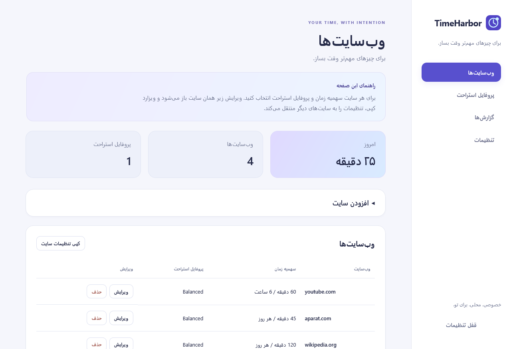

# TimeHarbor — تایم‌هاربر

**برای چیزهای مهم‌تر وقت بساز.**

افزونه متن‌باز مرورگر برای محدودیت زمان وب، استراحت‌های سالم و آگاهی بهتر از گذر زمان؛ با پیش‌فرض استفاده شخصی و امکان تنظیم برای خانواده. گزارش‌ها روی دستگاه شما می‌مانند.

این نسخه **آلفای ۰٫۴٫۰** است و هنوز در فروشگاه مرورگرها منتشر یا در Mozilla امضا نشده است. هدف، Firefox دسکتاپ نسخه ۱۴۲ به بعد و Chromium نسخه ۱۲۰ به بعد روی ویندوز، مک و لینوکس است؛ فعلاً آزمون مرورگر روی ویندوز اجرا شده است.



امکانات اولیه:

- سهمیه روزانه یا بازه‌ای از اولین استفاده برای هر سایت، و بلاک دائمی دستی.
- محافظت تنظیمات و وقفه با پین چهاررقمی؛ سقف تعداد وقفه روزانه و امکان غیرفعال‌کردن وقفه.
- پروفایل استراحت، پیام‌های دلخواه، چک‌لیست اجباری یا اختیاری و کپی گروهی قوانین سایت‌ها.
- ویرایش زیر همان سایت یا پروفایل، راهنمای صفحه و فیلدها، مدیریت سایت‌های متصل و ویزارد سه‌مرحله‌ای کپی تنظیمات.
- شمارش معکوس زنده؛ تأیید اجباری فعالیت‌ها پس از پایان زمان و ثبت اختیاری فعالیت‌ها از ابتدای استراحت. ادامه در هر دو حالت منتظر پایان زمان است؛ پرش زودتر فقط با اجازه جداگانه در پروفایل ممکن است.
- وقفه موقت فقط پس از پایان سهمیه مصرف قابل درخواست است و استراحت یا بلاک دائمی را دور نمی‌زند. سقف دفعات، بین همه سایت‌ها در هر روز مشترک است و با شروع بازه چندساعته تازه نمی‌شود.
- یادآوری متحرک مصرف با حدود هفت ثانیه مکث و دکمه بستن؛ نمایش سابقه فعالیت‌های استراحت در گزارش‌ها.
- خروجی و ورودی JSON تنظیمات بین مرورگرها با تأیید و اعتبارسنجی؛ بدون انتقال پین، نشست ورود و سابقه مصرف. پین مرورگر مقصد حفظ می‌شود و مصرف سایت‌های مشترک بازنشانی نمی‌شود. سینک خودکار بین مرورگرهای مختلف هنوز وجود ندارد.
- راهنمای بومی مرورگر با مکث ماوس و توضیح خوانا با کلیک، منوی آیکن افزونه و صفحه درباره همراه نام و راه‌های ارتباط با سعید سپهر.
- تشخیص فعالیت و پخش HTML audio/video، توقف شمارش هنگام بی‌فعالیتی و یادآوری مصرف.
- گزارش محلی روزانه، هفت‌روزه، سی‌روزه و بازه دلخواه همراه خروجی CSV.
- برچسب‌های رابط در هفت زبان و چیدمان راست‌به‌چپ فارسی و عربی. راهنماهای جدید فعلاً فارسی و انگلیسی‌اند و برای زبان‌های دیگر انگلیسی نمایش داده می‌شوند. پیام‌های خطا فعلاً انگلیسی‌اند.

برای نصب آزمایشی از سورس:

```sh
npm ci
npm run build
```

در فایرفاکس، `about:debugging#/runtime/this-firefox` را باز کنید، **Load Temporary Add-on** را بزنید و فایل `dist/manifest.json` را انتخاب کنید. اگر ZIP آماده را گرفته‌اید، ابتدا آن را استخراج و سپس `manifest.json` را انتخاب کنید. نصب آزمایشی پس از بستن و بازکردن فایرفاکس باقی نمی‌ماند؛ نسخه نصب دائمی به امضای Mozilla نیاز دارد.

ابتدا سایت‌ها را اضافه کنید، پروفایل استراحت را انتخاب کنید و در تنظیمات، زبان، دامنه گزارش‌گیری و پین را تعیین کنید. فرکانس استراحت صفر یعنی استراحت‌های جدید آن پروفایل خاموش باشند. برای وقفه، باید قبلاً پین تعریف شده باشد. پیش‌فرض خانواده با پین جدید اعمال می‌شود؛ قوانین هر سایت را پس از آن بررسی کنید.

برای به‌روزرسانی نسخه‌ای که از قبل لود کرده‌اید، فایل‌های جدید را در همان پوشه قبلی جایگزین کنید و در `about:debugging` روی **Reload** بزنید. شناسه افزونه ثابت است و پروفایل‌های قبلی با پرش غیرفعال سازگار می‌شوند. برای حفظ تنظیمات و گزارش‌ها، افزونه را حذف نکنید. قطع اتصال سایت از پروفایل، خود سایت و سهمیه‌اش را حذف نمی‌کند؛ فقط استراحت زمان‌بندی‌شده‌اش خاموش می‌شود.

موارد باقی‌مانده شامل فهرست آنلاین محتوای بزرگسالان، مسیر بازیابی پین، تنظیم مدیریتی جلوگیری از حذف، امضا و انتشار فروشگاهی و سینک خودکار بین مرورگرهاست. حذف‌ناپذیری یا حفاظت کامل کودک را برای نصب عادی ادعا نمی‌کنیم. تشخیص فعالیت و رسانه تقریبی است و همه پخش‌کننده‌ها و صفحات محافظت‌شده مرورگر را پوشش نمی‌دهد.

برای Chrome و Edge، `npm run build:chromium` را اجرا کنید و در `chrome://extensions` یا `edge://extensions` با روشن‌کردن Developer mode و انتخاب **Load unpacked** پوشه `dist-chromium` را انتخاب کنید. اگر آیکن در نوار ابزار نیست، از منوی پازل مرورگر TimeHarbor را سنجاق کنید. در تنظیمات، بخش «انتقال تنظیمات بین مرورگرها» فایل خروجی و ورودی را در اختیارتان می‌گذارد؛ مصرف هر مرورگر همچنان مستقل محاسبه می‌شود.

[راهنمای کامل انگلیسی و دستورات توسعه](README.md) · [نقشه راه](docs/roadmap.md) · [حریم خصوصی](PRIVACY.md)

در نسخه ۰٫۴ فقط تب قابل‌مشاهده در پنجره فعال محاسبه می‌شود؛ تب دیگر یا پنجره غیرفعال/مینیمایز فوراً از شمارش خارج می‌شود، حتی اگر رسانه در آن پخش شود. مهلت idle فقط برای بی‌فعالیتی روی همان صفحه فعال است. استثنای قدیمی رسانه پس‌زمینه خاموش شده است. نصب تازه زبان مرورگر را انتخاب می‌کند؛ برای تنظیمات موجود، گزینه «زبان مرورگر» در تنظیمات در دسترس است و انتخاب دستی قبلی حفظ می‌شود.

زیرساخت اتصال اختیاری Google Drive برای تنظیمات، گزارش و سهمیه مشترک آماده‌سازی شده، اما در بسته فعلی فعال نیست. فعال‌سازی به پروژه Google Cloud، سرویس امن OAuth و آزمون واقعی بین مرورگرها نیاز دارد. کلید محرمانه در افزونه قرار نمی‌گیرد؛ پین و تأیید چک‌لیست نیز ابری نمی‌شوند. در حالت آفلاین، آخرین مصرف مشترک ملاک است و سقف کاملاً هم‌زمان تضمین نمی‌شود. همگام‌سازی کاملاً محلی بین مرورگرها به یک برنامه همراه جدا نیاز دارد و فعلاً پیاده نشده است.
