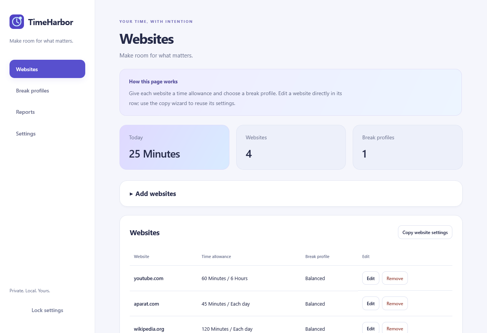

# TimeHarbor

**Make room for what matters.**

TimeHarbor is an open-source Firefox desktop extension for mindful browsing, healthier breaks, and clearer awareness of time. It is designed for personal productivity and configurable family routines, with reports stored on your device.

**Status: 0.2.0 alpha.** Working early implementation; not yet published or signed on Mozilla Add-ons. Firefox 142+ on desktop is the target. Automated browser checks have run on Windows; macOS and Linux still require validation.

[راهنمای فارسی](README.fa.md) · [Roadmap](docs/roadmap.md) · [Architecture](docs/architecture.md) · [Privacy](PRIVACY.md)



## Available in this alpha

- Per-domain daily allowances or first-use windows, such as 60 minutes in six hours. Matching includes subdomains and uses the most specific rule.
- Manual permanent website blocking and a lock page showing usage and the next reset time.
- Four-digit PIN protection for viewing/changing settings, PBKDF2 hashing with random salts, expiring sessions and failed-attempt backoff.
- PIN-protected quota pauses after the allowance runs out: 5, 15, 30, 60, 120, 180 or 240 minutes. The count limit is shared across websites per local calendar day, including for hourly quota windows. Pauses never bypass breaks or permanent blocks.
- Reusable break profiles with per-site assignment, optional global website scope, custom reminders and mandatory or optional checklists. Required confirmations appear after the timer; optional check-ins are usable during the break. Continue always waits for the minimum break duration. Early skipping is a separate per-profile setting, off by default.
- Inline website/profile editors, linked-site management, page guides and keyboard-accessible field help. Disconnecting a profile preserves website limits and turns off its scheduled breaks.
- A three-step copying wizard with source selection, identical-destination detection and a review before applying changes.
- Foreground interaction accounting, five-minute default idle detection, background HTML audio/video accounting and usage reminders. One domain is charged once per observation interval even if several tabs are open.
- Local usage reports with today, last-seven-days, last-thirty-days and custom date ranges, usage CSV export, break activity records and configurable retention (90 days by default).
- English, Persian, Arabic, Spanish, French, German and Chinese menu labels, with RTL layouts for Persian and Arabic. Translations are preliminary; new explanatory help is English/Persian with English fallback, and validation messages currently use English.
- No production runtime npm dependencies, account requirement, analytics, or external reporting service.

## Development and temporary installation

Use Node.js 22.14+ and npm:

```sh
npm ci
npm run typecheck
npm test
npm run build
npm run lint:extension
```

In Firefox, open `about:debugging#/runtime/this-firefox`, choose **Load Temporary Add-on**, then select `dist/manifest.json`. Or run `npm start` to launch an isolated development profile through Mozilla's `web-ext`.

A temporary installation is removed when Firefox restarts. An unsigned ZIP is a development artifact, not a permanently installable Firefox release. Mozilla signing and store publication are future work.

```sh
npm run package          # outputs/timeharbor-0.2.0.zip
npm run test:coverage
npm run test:firefox     # isolated Firefox addon + local HTTP fixture + UI previews
npm run format:check
```

Selenium Manager may download Firefox/geckodriver into its user cache on first browser-test execution. The browser test uses a separate temporary profile and a test-only helper, not your normal Firefox profile. It does not change your browsing settings. See [validation evidence](docs/validation.md).

## Getting started

1. Add website domains and choose a daily or first-use allowance.
2. Create break profiles and assign them to websites. A break frequency of **0** disables new scheduled breaks for that profile.
3. In Settings, choose whether to record only configured domains or all visited domains, select retention and set a PIN if desired. Pausing requires a configured PIN.
4. The family-defaults button requires a new PIN, disables temporary pauses and early break skipping, and makes profile checklists mandatory. Review the resulting site rules yourself.

To update an already loaded development build, replace the extracted files in the same folder and use **Reload** in `about:debugging`. The extension ID is unchanged, and old profiles acquire the new skip setting with skipping disabled. Avoid removing the addon when preserving its local settings/history.

## Practical boundaries

This alpha is a browser-level aid, not tamper-proof parental control. Ordinary extensions cannot require a PIN to prevent their own removal. A person controlling the device can remove the addon, reset its storage, change the clock, use a different browser or edit an open-source build. Administrative Firefox policy is a separate future setup path.

Idle/media accounting is approximate: content heartbeats are five seconds apart and checkpoints are normally ten seconds apart. Browser crashes can lose the last checkpoint interval. Long unobserved gaps are not charged. Embedded/cross-origin or non-HTML media players, muted playback policies and restricted browser pages need further compatibility work. Checklists are self-reported; the extension cannot verify that a physical activity happened.

Online adult-content lists, protected allowlist management, a PIN recovery flow, permanent signing/distribution, complete platform coverage and Chromium builds are not implemented yet. Domain lists also cannot classify every item within a general platform such as YouTube.

The current tooling audit reports three **low-severity development-only** findings in `web-ext → addons-linter → deepmerge`; the registry's suggested fix downgrades `web-ext` to an obsolete major and is not applied. There are no production npm dependencies; `npm audit --omit=dev` reports zero findings. Track the upstream tooling fix rather than using a forced downgrade.

## Contributing

Use the workflow in [AGENTS.md](AGENTS.md): plan → implement → test → review → verify. Keep the core independent of browser APIs, preserve CSP, justify every permission and avoid transmitting browsing data. Please document actual validation limits instead of claiming untested platforms pass.

MIT © 2026 Saeed Sepehr.
